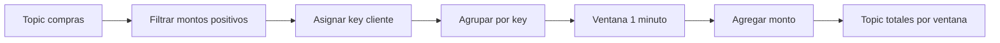

# Ejemplo 03 · Ventanas y agregaciones

Evento = `{clienteId, monto, fechaEvento}`. Filtrar montos positivos, agrupar por cliente y agregar en ventanas tumbling de 1 minuto.

| Timestamp | Cliente | Monto |
|---|---|---:|
| 10:00:05 | A | 100 |
| 10:00:15 | B | 50 |
| 10:00:45 | A | 200 |
| 10:01:05 | B | 75 |

**Resultado:** [10:00,10:01): A=300, B=50; [10:01,10:02): B=75.

Filtrado es stateless; agregación con ventanas requiere state store y recuperación. Ventanas deben considerar timestamps, retrasos y grace. **Diagrama conceptual, no código ejecutable**.
