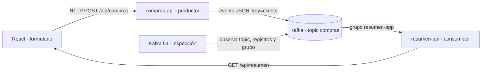

# Observación visual del flujo end-to-end · Complemento AVA 3.2.1 y 3.2.2

**Este documento acompaña al [laboratorio B](./LAB-WEBAPP-PASO-A-PASO.md).** El alumno recibe el código funcional y completa configuraciones. Aquí no hay que implementar otro microservicio ni cambiar Java/React. Las guías institucionales de AVA (2025) se utilizan como referencia didáctica.

## Mapa del recorrido · De una compra a un resumen

**No confundas:** React no es un producer Kafka. Quien publica en Kafka es **compras-api**. Kafka UI no ejecuta el negocio: **permite ver qué ocurrió**.

## Checkpoint visual 1 · Encontrar el evento

1. Desde `labs\kafka-compras-webapp`, sigue la guía principal hasta que la web esté funcionando.
2. Desde React en **http://localhost:5173**, envía una compra: cliente **Ana**, monto **150**.
3. Abre en otra pestaña **http://localhost:8083**.
4. Entra a **Topics → compras → Messages** (nombres visuales aproximados).
5. Encuentra un registro cuyo contenido JSON incluya `"cliente":"Ana"` y `"monto":150`.
6. Identifica `Key`, `Value`, `Partition` y `Offset`. Compáralos con la tabla de la web.

**Qué significa cada dato:**
- **Key:** `Ana`. Kafka la utiliza para asignar una partición según el particionador.
- **Value:** JSON con `id`, `cliente`, `monto`, `fechaEvento`.
- **Partition:** secuencia concreta dentro del topic.
- **Offset:** posición de ese evento **en su partición**. No existe un único contador global.
- **Topic:** `compras`, donde los productores publican eventos.

**✅ Evidencia:** dos capturas del **mismo evento**, una en React y otra en Kafka UI. Si la interfaz no muestra inmediatamente el evento, actualiza la consulta de mensajes y revisa filtros.

## Checkpoint visual 2 · El efecto de repetir la clave

1. Publica dos compras adicionales de Ana y otra de Luis.
2. En Kafka UI compara las particiones de los eventos de Ana.
3. Anota los offsets en esa partición. **No esperes** que empiecen en cero si ya hubo actividad anterior.

**¿Por qué ocurre?** En la configuración habitual, una key estable permite afinidad a una partición y preserva **orden dentro de ella**. Si cambia la cantidad de particiones o la estrategia del productor, la afinidad podría cambiar.

**Pregunta:** ¿se garantiza el orden de Ana frente a Luis si caen en particiones diferentes? **No**: el orden total entre particiones no existe.

## Checkpoint visual 3 · Consumer groups, lag y replay

1. En Kafka UI abre **Consumer Groups** y localiza `resumen-app`.
2. Identifica cuántas particiones consume y qué offsets tiene confirmados.
3. Detén **solo** `resumen-api`, no Kafka. Publica una compra nueva desde React.
4. Observa el grupo en Kafka UI: el **lag puede aumentar** mientras la aplicación consumidora está detenida.
5. Inicia `resumen-api` de nuevo y observa cómo procesa pendientes. Para ejecutar **replay histórico**, sigue el checkpoint 7 de la guía principal: detén el grupo, resetea offsets y recién entonces reinicia el consumidor.

**Importante:** lag es diferencia de posiciones respecto del avance confirmado, no «segundos pendientes». `auto-offset-reset=earliest` **no** borra offsets ya confirmados.

**✅ Evidencia:** capturas del grupo antes y después, y explicación de por qué Kafka puede conservar eventos ya procesados.

## Checkpoint conceptual 4 · Relación con el pipeline bancario de AVA 3.2.2

La guía institucional propone un caso distinto: **transacciones bancarias** que ingresan al topic de entrada, se filtran, detectan como sospechosas si superan un umbral, y producen alertas en otro topic.

| Etapa de la guía bancaria | ¿Existe hoy en este laboratorio de compras? |
|---|---|
| Entrada HTTP y publicación a Kafka | **Sí**, mediante `compras-api` |
| Topic de entrada y consumidor | **Sí**, `compras` y `resumen-api` |
| Acumular montos por cliente | **Sí**, pero en memoria con Spring Kafka; **no Kafka Streams** |
| Filtrar montos menores a cierto límite | **No**, no existe esa regla de negocio |
| Detección de transacciones sospechosas | **No**, no existe lógica antifraude |
| Enriquecimiento a USD | **No** |
| Topic final con alertas | **No**, solo se utiliza `compras` |
| Topología real de Kafka Streams y state stores | **No**; se explica y diseña en papel |

**Actividad sin código:** dibuja sobre nuestro flujo dónde insertarías un procesamiento de `filter → map/enrich → detect/aggregate → sink` con los topics de la guía bancaria. Señala qué pasos serían sin estado y cuáles necesitarían estado.

**Atención a una discrepancia en AVA:** el contexto de 3.2.2 menciona conversión de moneda y agregación por usuario, pero la topología Java mostrada desarrolla principalmente **filtro, alerta y publicación**, sin implementar esas dos operaciones prometidas. No confundas la *intención curricular* con un comportamiento demostrado por el código mostrado.

## Si algo no aparece en Kafka UI

- **No abre 8083:** revisa `docker compose --profile app ps`; hay un contenedor adicional `kafka-ui`. El puerto 8083 es del navegador en Windows, 8080 es interno al contenedor UI.
- **Kafka UI abre pero está desconectada:** verifica que Kafka esté saludable y la UI use `kafka:9094` dentro de Docker.
- **El topic aparece vacío:** revisa que hayas publicado desde el frontend, el nombre `compras`, la selección de particiones y los filtros de mensajes.
- **El resumen no coincide:** podría haber eventos de prácticas anteriores o offsets ya confirmados. No borres datos antes de comprender qué pasó.
- **No aparece el consumer group:** genera y consume eventos, espera unos segundos y refresca la vista.

La herramienta utilizada es **Kafbat UI**, continuidad comunitaria de Kafka UI. Conservamos el objetivo visual de las guías AVA sin instalar ZooKeeper ni requerir más software en Windows.
