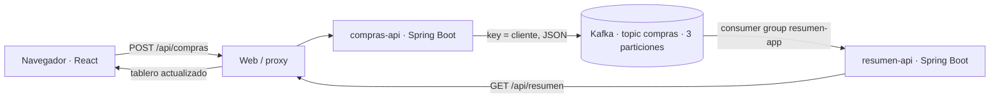

# Semana 12 · Laboratorio guiado: React + dos microservicios Spring Boot + Kafka

**Objetivo:** poner en funcionamiento una aplicación completa a partir de código **ya programado**, configurando servicios, redes, topic y consumo de eventos. **No hay que crear componentes React, programar controllers ni construir microservicios desde cero.**

**Entorno de los estudiantes:** Windows 10, Docker Desktop abierto en modo Linux containers, PowerShell, navegador y editor de texto (Bloc de notas o VS Code). **No instalar Java, Maven, Node, Make, Bash ni abrir WSL.** Docker compila Java y React dentro de sus imágenes. La primera compilación requiere Internet y recursos suficientes; el laboratorio debe tener Docker Desktop habilitado previamente por la institución.

> El laboratorio tiene dos modalidades en el mismo `compose.yaml`: `docker compose up -d` ejecuta **solo Kafka** para las prácticas de terminal 01–02; `docker compose --profile app up -d --build` incluye también **React + ambos microservicios**.

## El caso: «Compras en tiempo real»

Imagina una tienda donde cada compra debe registrarse y alimentar un tablero de ventas.



- **React**: formulario y tablero, consulta el resumen cada dos segundos.
- **compras-api**: recibe la compra por REST, publica un JSON en Kafka, usando `cliente` como **key**.
- **Kafka**: topic `compras`, tres particiones, retiene eventos y conserva offsets por grupo.
- **resumen-api**: consume eventos en el grupo `resumen-app`, calcula totales **en memoria** y expone el resultado por REST.
- **Proxy web**: enruta `/api/compras` y `/api/resumen` a cada servicio. El navegador solo conoce una dirección (`localhost:5173`).

El código fuente ya está entregado en [`webapp/`](./webapp/). **Únicamente se editan dos archivos de configuración:** `.env` y `webapp/web/nginx/default.conf`.

---

## Checkpoint 0 · Docker funcionando

**Paso 0.1.** Abre Docker Desktop y espera a que el motor figure iniciado.

**Paso 0.2.** Descarga el repositorio como ZIP desde GitHub (`Code → Download ZIP`) y descomprímelo, o usa el repositorio que ya tienes. En el Explorador de archivos, entra a `labs\kafka-streaming`. Haz clic en la barra de direcciones, escribe `powershell` y pulsa Enter. La terminal se abrirá en esa carpeta.

**Paso 0.3.** Ejecuta:

```powershell
docker --version
docker compose version
```

**✅ Verificación:** ambos comandos muestran versiones; no aparece «comando no reconocido». Si Docker no está listo, solicita apoyo en el laboratorio antes de continuar.

## Checkpoint 1 · Broker Kafka + topic

**Paso 1.1.** Desde `labs\kafka-streaming`, inicia solo Kafka:

```powershell
docker compose up -d
docker compose ps
```

La primera ejecución descargará `apache/kafka:4.1.2`. Si Kafka aún está arrancando, aguarda a que el contenedor esté saludable.

**Paso 1.2.** Comprueba el broker:

```powershell
docker exec dsy1107-kafka-s12 /opt/kafka/bin/kafka-broker-api-versions.sh --bootstrap-server localhost:9092
```

**Paso 1.3.** Crea el topic de tres particiones (repetible):

```powershell
docker exec dsy1107-kafka-s12 /opt/kafka/bin/kafka-topics.sh --bootstrap-server localhost:9092 --create --if-not-exists --topic compras --partitions 3 --replication-factor 1
```

**Paso 1.4.** Comprueba sus particiones:

```powershell
docker exec dsy1107-kafka-s12 /opt/kafka/bin/kafka-topics.sh --bootstrap-server localhost:9092 --describe --topic compras
```

**✅ Verificación:** topic `compras` con `PartitionCount: 3` y `ReplicationFactor: 1` (la salida exacta puede variar).

**💡 Conecta con la teoría:** topic, particiones, retención y replicación. **Una réplica no proporciona alta disponibilidad.**

**¿Por qué aparecen archivos `.sh`?** Son ejecutables **dentro del contenedor Kafka**, llamados mediante `docker exec` desde Windows. No estás instalando ni abriendo Linux.

## Checkpoint 2 · Configuración de los microservicios

**Paso 2.1.** En la misma PowerShell, crea una copia editable de la plantilla:

```powershell
Copy-Item .env.example .env
notepad .env
```

**Paso 2.2.** Completa el archivo `.env` exactamente así (sin comillas):

```dotenv
KAFKA_BROKER=kafka:9094
KAFKA_TOPIC=compras
KAFKA_GROUP=resumen-app
WEB_PORT=5173
```

Guarda y cierra Bloc de notas.

**¿Qué configuraste?**

| Variable | Por qué existe |
|---|---|
| `KAFKA_BROKER=kafka:9094` | Los microservicios **dentro de Docker** descubren a Kafka por nombre de servicio y puerto **interno**; **no** usan `localhost:9092`. |
| `KAFKA_TOPIC=compras` | Productor y consumidor deben referirse al **mismo topic** creado en el checkpoint 1. |
| `KAFKA_GROUP=resumen-app` | El consumidor mantiene sus propios offsets, independientes de otros grupos. |
| `WEB_PORT=5173` | Puerto que usará el navegador de Windows para ingresar a la web. |

**Paso 2.3.** Comprueba la configuración que Docker Compose interpreta:

```powershell
docker compose --profile app config
```

**✅ Verificación:** identifica las secciones `compras-api`, `resumen-api`, `web`, `kafka` y los valores `kafka:9094`, `compras`, `resumen-app`. **Si aparece `PENDIENTE`, revisa el `.env` antes de continuar.**

**💡 Conecta con la teoría:** `localhost` significa **el equipo o contenedor desde donde se consulta**, no «todos los servicios». La red de Compose permite resolver `kafka` por nombre.

## Checkpoint 3 · Rutas entre React y los microservicios

**Paso 3.1.** Abre el archivo de configuración del proxy:

```powershell
notepad webapp\web\nginx\default.conf
```

**Paso 3.2.** Busca dos nombres **sin configurar** y sustitúyelos, conservando el resto del archivo:

- `__SERVICIO_COMPRAS__` → `compras-api`
- `__SERVICIO_RESUMEN__` → `resumen-api`

Las dos líneas finales deben quedar así:

```nginx
proxy_pass http://compras-api:8080;
proxy_pass http://resumen-api:8080;
```

**✅ Verificación:** no quedan marcadores `__SERVICIO_...__` en el archivo. Esos nombres deben coincidir con los servicios declarados en `compose.yaml`.

**💡 Conecta con la teoría:** la web habla HTTP/REST; **Kafka conecta al productor con el consumidor**. React **no publica directamente en Kafka**.

## Checkpoint 4 · Levantar la aplicación completa

**Paso 4.1.** En `labs\kafka-streaming`, ejecuta:

```powershell
docker compose --profile app up -d --build
```

En la primera ejecución Docker descargará imágenes de Java/Maven/Node y compilará los proyectos. El equipo necesita Internet para descargar dependencias Maven y npm; no hace falta instalarlas en Windows.

**Paso 4.2.** Comprueba los cuatro servicios:

```powershell
docker compose --profile app ps
```

**Paso 4.3.** Desde PowerShell comprueba cada API por separado:

```powershell
Invoke-RestMethod http://localhost:8081/api/compras/salud
Invoke-RestMethod http://localhost:8082/api/resumen/salud
```

**✅ Verificación:** ambas devuelven `estado: ok`.

**Paso 4.4.** Abre el navegador en **http://localhost:5173**. Debes ver el formulario, el resumen y la tabla de eventos.

**✅ Verificación:** aparece «Resumen conectado». Si no: ejecuta `docker compose --profile app logs --tail=50 web` o los logs del servicio que falle. **Si el puerto 5173 está ocupado, cambia `WEB_PORT` en `.env` y repite el comando del paso 4.1.**

**💡 Conecta con la teoría:** la web hace peticiones REST; cada microservicio tiene su propio proceso; Kafka desacopla la publicación del procesamiento.

## Checkpoint 5 · Producir, consumir y ver particiones/offsets

**Paso 5.1.** En la web, envía sucesivamente cuatro compras:

| Cliente | Monto |
|---|---:|
| Ana | 100 |
| Luis | 50 |
| Ana | 200 |
| Luis | 75 |

**Paso 5.2.** Observa la tabla «Eventos consumidos». Debe mostrar el cliente, monto, partición, offset e ID (los números concretos de partición/offset **dependen del estado del topic**, no están predefinidos).

**Paso 5.3.** Observa el resumen: **Ana = 300; Luis = 125; total 4 compras**, siempre que hayas empezado con un topic sin eventos anteriores. Si el topic ya tenía eventos de otros ejercicios, los totales pueden ser mayores; **no borres datos sin autorización docente**.

**Paso 5.4.** Alternativamente puedes publicar sin la web, directamente desde PowerShell:

```powershell
Invoke-RestMethod -Method Post -Uri http://localhost:8081/api/compras -ContentType "application/json" -Body '{"cliente":"Ana","monto":90}'
```

**✅ Evidencia:** captura de la web mostrando compras, claves, particiones y offsets; explica por qué los eventos de Ana conservan la partición. El orden solo se garantiza **dentro de cada partición**.

## Checkpoint 6 · Segundo consumer group independiente

**Paso 6.1.** Abre **otra PowerShell**. Inicia un consumidor adicional, esta vez en el grupo `auditoria-s12`:

```powershell
docker exec -it dsy1107-kafka-s12 /opt/kafka/bin/kafka-console-consumer.sh --bootstrap-server localhost:9092 --topic compras --group auditoria-s12 --from-beginning --property print.key=true --property print.partition=true --property print.offset=true
```

**Paso 6.2.** Sin cerrar esa consola, publica desde la web una compra nueva de Ana. Debes observarla tanto en la web (grupo `resumen-app`) como en la consola (grupo `auditoria-s12`). Para detener el consumidor de auditoría, usa **Ctrl+C**.

**✅ Verificación:** dos grupos diferentes pueden leer el **mismo evento**. No se «roban» mensajes entre grupos.

**💡 Reflexión:** ¿qué cambiaría si dos instancias pertenecieran al **mismo** grupo? ¿Cuántas podrían procesar particiones simultáneamente en un topic de tres particiones?

## Checkpoint 7 · Replay: reconstruir el tablero

**Paso 7.1.** Comprueba que tienes compras visibles en la web. **Detén solo el consumidor de resumen**, manteniendo Kafka encendido:

```powershell
docker compose --profile app stop resumen-api
```

**Paso 7.2.** Con el grupo `resumen-app` **sin miembros activos**, devuelve sus offsets al comienzo:

```powershell
docker exec dsy1107-kafka-s12 /opt/kafka/bin/kafka-consumer-groups.sh --bootstrap-server localhost:9092 --group resumen-app --topic compras --reset-offsets --to-earliest --execute
```

Si Kafka indica que el grupo está activo, espera a que termine la salida del consumidor y repite la operación.

**Paso 7.3.** Inicia nuevamente el microservicio:

```powershell
docker compose --profile app start resumen-api
```

**Paso 7.4.** Recarga http://localhost:5173 y observa cómo el resumen se **reconstruye desde los eventos retenidos**. El estado anterior estaba únicamente en memoria; el proceso reiniciado comienza con un resumen vacío. Sin el reset, arrancaría desde los offsets ya confirmados y **no reconstruiría todo el historial**.

**✅ Evidencia:** captura del resumen reconstruido. Explica qué problema surgiría si cada evento reejecutara un cobro real sin mecanismos de idempotencia.

## Checkpoint 8 · Relación con Kafka Streams (diseño, sin programar)

Abre el [Laboratorio 03 de ventanas](./03-streams-diseno.md). Con los eventos de compra, dibuja una topología conceptual `filter → groupByKey → windowedBy → aggregate`; calcula montos en ventanas de un minuto.

**✅ Evidencia:** diagrama y cálculo correcto. Nuestro `resumen-api` es un **consumidor Spring Kafka con un agregado en memoria**; **NO es una implementación de Kafka Streams**. La diferencia debe quedar explícita.

---

## Ayuda rápida para los estudiantes

| Síntoma | Qué revisar |
|---|---|
| `docker` no funciona | Docker Desktop abierto, motor listo y contenedores Linux habilitados por el encargado |
| `PENDIENTE` en `docker compose --profile app config` | Valores no completados en `.env` |
| API no logra conectar a Kafka | `KAFKA_BROKER=kafka:9094`, nunca `localhost:9092` entre contenedores |
| La web devuelve 502 | nombres de los dos servicios en `webapp/web/nginx/default.conf`; servicios arrancados |
| No se reciben compras | nombre de topic `compras`, tres particiones, estado de `resumen-api` |
| La compilación falla descargando dependencias | conectividad a Internet del laboratorio, acceso a registros Docker/Maven/npm |
| El resumen tiene compras antiguas | el topic retiene eventos de prácticas anteriores; la cifra no parte de cero automáticamente |

Comandos de ayuda (desde la carpeta del laboratorio):

```powershell
docker compose --profile app ps
docker compose --profile app logs --tail=50 compras-api
docker compose --profile app logs --tail=50 resumen-api
docker compose --profile app logs --tail=50 web
```

**Apagado normal** (mantiene datos retenidos mientras persista el contenedor):

```powershell
docker compose --profile app down
```

**Atención:** `docker compose down` elimina el contenedor Kafka; en este laboratorio el broker **no usa volumen persistente** y se perderán los eventos cuando se elimine el contenedor. No ejecutar `down` entre los checkpoints 1 y 7.

## Evidencias de entrega

1. Captura: topic y tres particiones (checkpoint 1).
2. Captura: `docker compose --profile app ps` y ambas APIs saludables (checkpoint 4).
3. Captura: web, totales y columnas de partición/offset (checkpoint 5).
4. Explicación breve: dos grupos, replay e idempotencia (checkpoints 6 y 7).
5. Diagrama de ventanas conceptual (checkpoint 8).

**Criterio de logro:** demostrar **que configuraste e integraste** una aplicación distribuida, no escribir código base desde cero. Solo entorno de aprendizaje: sin autenticación, sin persistencia duradera de agregados, sin alta disponibilidad y sin seguridad de Kafka.
