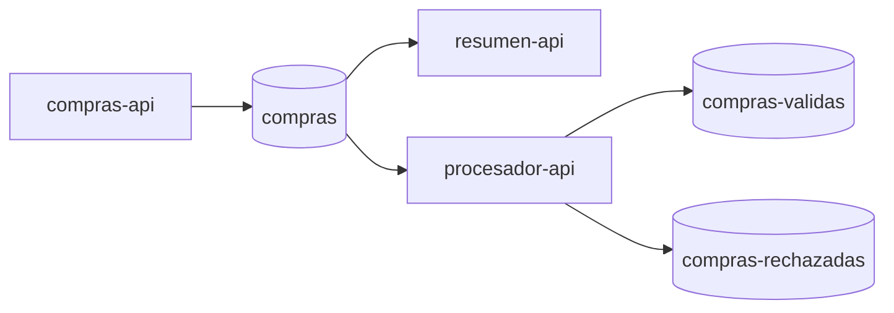

# Guion de clase · Semana 14

**Tema:** operar y ajustar una plataforma Kafka.  
**Caso conductor:** compras en tiempo real, continuando la aplicación de semanas 12 y 13.

## Apertura: de integrar a operar

Recordar el flujo ya conocido:

Preguntar: ¿qué ocurre si llegan más compras de las que podemos procesar?, ¿qué ocurre si se detiene un consumidor?, ¿qué ocurre si cae el broker?, ¿cuánto tiempo necesitamos conservar los eventos?

Aclarar que son problemas diferentes y requieren mecanismos diferentes.

## Bloque 1 · Escalamiento y consumer groups

1. Mostrar el topic `compras` con tres particiones.
2. Consultar el grupo `resumen-s14` y el grupo `procesador-s13`.
3. Explicar que los dos grupos leen independientemente el mismo topic.
4. Abrir dos consumidores de consola en el mismo grupo `escalamiento-s14` y publicar eventos nuevos.
5. Observar la asignación de particiones.
6. Preguntar qué sucede al agregar un tercer consumidor y luego un cuarto.

**Cierre del bloque:** el paralelismo de un grupo depende de las particiones, no solo del número de instancias.

## Bloque 2 · Replicación y retención

1. Explicar RF=1 del broker local.
2. Mostrar leader y replicas en la descripción del topic.
3. Explicar RF=3, ISR, `acks=all` y `min.insync.replicas`.
4. Contrastar retención por tiempo y tamaño.
5. Comparar `delete` y `compact` mediante ejemplos de eventos e información de estado.
6. Aplicar la configuración de retención a `compras` y `compras-validas`.

**Cierre del bloque:** una copia no es replicación; consumir un evento no lo elimina; compactar no equivale a conservar todo el historial.

## Bloque 3 · Consumer lag

1. Confirmar que `resumen-s14` tiene offsets.
2. Detener `resumen-api` sin detener Kafka ni `compras-api`.
3. Generar un lote de compras.
4. Consultar lag desde Kafbat UI o CLI.
5. Reiniciar `resumen-api`.
6. Observar la disminución del lag.
7. Identificar qué evidencia demuestra que el grupo se recuperó.

**Cierre del bloque:** un lag creciente significa que la tasa de entrada supera la capacidad efectiva de procesamiento o que el consumidor no está avanzando.

## Bloque 4 · Tuning y pruebas de carga

1. Explicar `batch.size`, `linger.ms`, `buffer.memory` y `compression.type`.
2. Ejecutar prueba de productor con configuración base.
3. Ejecutar la misma prueba con configuración ajustada.
4. Registrar registros, tamaño, tiempo, throughput y latencia reportados.
5. Discutir CPU, memoria, red y efecto sobre consumo.
6. Evitar declarar una mejora si solo se midió el despacho o si las condiciones cambiaron.

**Cierre del bloque:** tuning es hipótesis + medición + comparación, no copiar valores de una receta.

## Orientación de Evaluación Parcial 3

Cerrar mostrando el documento [Instrucciones de preparación EP3](../../evaluaciones/ev3/instrucciones-encargo.md). Explicar que la evaluación se realizará en semana 16, que se debe integrar Kafka al proyecto semestral sin romper RabbitMQ y que el detalle oficial de ponderación/rúbrica se rige por AVA.

## Adaptación para 003D (dos bloques)

Priorizar:

- contraste entre particiones y consumer groups;
- conceptos de RF/ISR y límites del broker único;
- retención y políticas de limpieza;
- configuración de dos topics;
- observar lag y explicar cómo se recupera;
- entregar orientación EP3.

Si el tiempo no alcanza para una prueba baseline/tuned completa, dejar el procedimiento y la tabla de registro como trabajo autónomo. No simular resultados ni afirmar ejecución.
